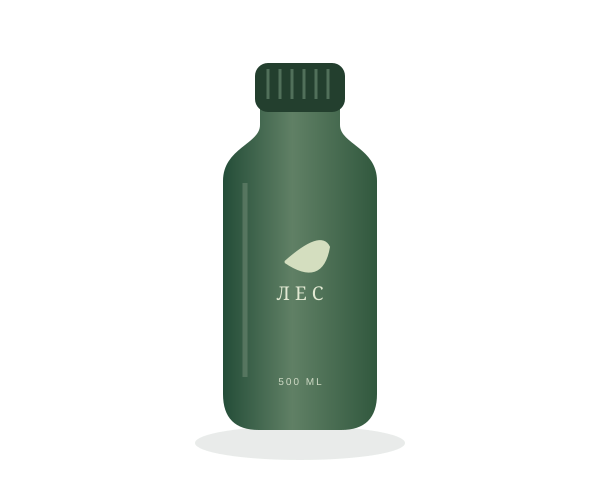

# Зелёный магазин: адаптивность и доступность

Контрольная работа №3 по дисциплине «Фронтенд и бэкенд разработка».

Тема: «Адаптивная вёрстка и доступность многостраничного HTML/CSS-сайта».

Автор: Киселев Максим Андреевич, группа ЭФБО-01-25.

Магазин многоразовых вещей продолжает HTML/CSS-проект КР №1: сохранены зелёная палитра, иллюстрации, шесть товаров, описания и форма заявки. Bootstrap и другие CSS-фреймворки не подключаются. Сетка и адаптивные правила написаны самостоятельно.

- Репозиторий: [K1apy/kr3-responsive-shop](https://github.com/K1apy/kr3-responsive-shop).
- Сайт: [Зелёный магазин](https://k1apy.github.io/kr3-responsive-shop/).

## Запуск и структура

Откройте `index.html` в браузере или папку проекта в VS Code и запустите Live Server. Сборка, npm и внешние CDN для работы магазина не нужны. Все изображения и скрипты локальные.

```text
kr3-responsive-shop/
├── index.html
├── catalog.html
├── product.html
├── order.html
├── contacts.html
├── css/
│   ├── style.css
│   └── responsive.css
├── js/
│   └── main.js
├── images/
│   ├── favicon.svg
│   ├── bottle.svg, bag.svg, kit.svg, brush.svg, covers.svg, picnic.svg
│   └── варианты товаров *-480.webp, *-960.webp, *-1440.webp
├── lighthouse/
│   ├── index-accessibility.html
│   ├── catalog-accessibility.html
│   ├── product-accessibility.html
│   ├── order-accessibility.html
│   └── contacts-accessibility.html
├── README.md
├── .gitignore
└── .nojekyll
```

На каждой странице задан `lang="ru"`, один `h1`, один `main` и метатег `viewport` со значением `width=device-width, initial-scale=1.0`.

Сначала подключается `css/style.css`, затем `css/responsive.css`. В первом находятся оформление, компоненты и базовая структура в одну колонку. Во втором - правила для разных размеров окна. Более позднее подключение позволяет переопределять правила оформления там, где это требуется.

## Адаптивные решения

Использован подход Mobile First: основа рассчитана на узкий экран, а медиазапросы `min-width` расширяют её по мере появления свободного места.

| Ширина от      | Изменения                                                                                                           |
| -------------- | ------------------------------------------------------------------------------------------------------------------- |
| Базовая версия | Одна колонка товаров и формы; меню и фильтры раскрываются кнопками; таблицы заменяются карточками                   |
| 430 px         | Больше высота композиции первого экрана                                                                             |
| 640 px         | Две колонки товаров и формы; табличное представление; две колонки подвала                                           |
| 768 px         | Преимущества в три колонки; описание товара, контакты и блок обратной связи в две                                   |
| 1024 px        | Постоянная горизонтальная навигация; hero в две колонки; фильтр сбоку; три популярных товара; каталог в две колонки |
| 1152 px        | Три колонки каталога при боковом фильтре; дополнительная ссылка заявки в шапке                                      |
| 1280 px        | Более широкие отступы, увеличенная композиция hero и промежуток в описании товара                                   |

Точки перестроения выбраны по вместимости содержимого. Например, три карточки с боковым фильтром появляются позже, чем три карточки на главной.

- **Flexbox:** шапка, навигация, действия формы, нижняя часть карточки и подвал. `flex-wrap` позволяет переносить действия на следующую строку.
- **Grid:** товары, преимущества, описание товара, форма, контакты и общий каталог. `minmax(0, 1fr)` и `min-width: 0` позволяют колонкам сжиматься без переполнения.
- **Контейнер:** ограничен 1200 px, на телефоне оставляет по 16 px с каждой стороны. Размеры заголовков частично задаются через `clamp()`.
- **Hero:** на телефоне текст расположен над иллюстрацией. Абсолютное позиционирование применяется только внутри ограниченной композиции; обрезка декоративной композиции не используется для маскировки переполнения всей страницы.
- **Формы:** на телефоне поля стоят в одну колонку; элементы занимают доступную ширину, а шрифт ввода равен 16 px. Кнопки и основные элементы управления имеют высоту не менее 44 px.
- **Подвал:** `body` использует вертикальный Flexbox с `min-height: 100dvh`, `main` растягивается через `flex: 1`. При уменьшении масштаба подвал остаётся внизу короткой страницы.
- **Диалоги:** ширина ограничена размером окна, максимальная высота учитывает `100dvh`. Содержимое большого окна можно прокрутить.

## Навигация и фильтры

На мобильной ширине кнопка «Меню» раскрывает обычную навигацию. Её `aria-expanded` соответствует состоянию, а `aria-controls` указывает на раскрываемый блок. Меню закрывается по Escape, нажатию вне шапки и переходу по ссылке. После Escape фокус возвращается кнопке. При уменьшении окна фокус из скрываемой навигации также возвращается кнопке.

На desktop ссылки видны постоянно. Без JavaScript навигация остаётся раскрытой и доступной.

В каталоге фильтр раскрывается кнопкой на узком экране и становится боковым блоком от 1024 px. Реально работают поиск по названию, выбор категории и стоимость. Все ограничения применяются вместе после нажатия «Показать»; поиск не учитывает регистр. Границы цены не пересекаются: до 1000 ₽ включительно и больше 1000 ₽.

Рядом с результатами показывается количество найденных товаров с `role="status"`. Разделы без подходящих товаров скрываются через `hidden`. При пустом результате есть сообщение и кнопка сброса. На телефоне после применения фильтр сворачивается, а каталог прокручивается к результатам. Сброс возвращает все шесть товаров. Без JavaScript виден полный каталог; фильтрация требует JavaScript и это пояснено в интерфейсе.

## Изображения

Базовое правило для `img, video`: `max-width: 100%; height: auto`.

Для каждого из шести товаров подготовлены WebP шириной 480, 960 и 1440 px. В карточках, описаниях и боковом блоке заявки используется `picture`:

```html
<picture>
  <source
    type="image/webp"
    srcset="
      images/bottle-480.webp   480w,
      images/bottle-960.webp   960w,
      images/bottle-1440.webp 1440w
    "
    sizes="(min-width: 1280px) 570px,
           (min-width: 768px) calc((100vw - 100px) / 2),
           calc(100vw - 34px)"
  />
  
</picture>
```

Это пример для страницы товара; значения `sizes` у карточек учитывают другую сетку. Браузер выбирает подходящий WebP по ширине места и плотности пикселей экрана. Исходный SVG служит запасным вариантом. Логотип и композиция hero используют масштабируемые SVG. У изображений ниже первого экрана сохранена ленивая загрузка.

Проверка: открыть Network, отключить кеш и перезагрузить страницу при разных размерах окна. В консоли `document.querySelector('picture img').currentSrc` показывает выбранный файл. Браузер может оставить уже загруженный большой вариант после уменьшения окна; для сравнения нужна новая загрузка без кеша.

## Таблицы

От 640 px характеристики остаются обычными таблицами с `caption`, заголовками и `scope`. Обёртка `.table-wrap` даёт локальную горизонтальную прокрутку, если места недостаточно. Для доступа с клавиатуры у неё есть `tabindex="0"`, роль именованной области и фокус.

До 640 px вместо широкой таблицы сравнения показываются три карточки товаров со списками `dl`, `dt`, `dd`. На странице товара характеристики также представлены списком пар «параметр - значение». Это дополнительная доработка сверх базовой прокрутки таблицы.

Ненужное на данной ширине представление скрывается через `display: none`, поэтому не дублируется в дереве доступности. Оба представления содержат одинаковые сведения; при изменении характеристик нужно обновлять оба.

## Доступность

- Ссылка пропуска навигации появляется при первом Tab и переводит фокус в `main` с `tabindex="-1"`.
- Для интерактивных элементов задан заметный `:focus-visible` с отступом.
- Используются семантические `header`, `nav`, `main`, `section`, `article`, `aside`, `footer`; заголовки образуют последовательную структуру.
- Все поля связаны с `label`; группы полей оформлены через `fieldset` и `legend`. Подсказки связаны через `aria-describedby`, где это нужно.
- У иллюстраций осмысленные `alt`; значок логотипа имеет пустой `alt`, потому что рядом есть название магазина.
- Текстовое название логотипа используется как доступное имя без лишнего `aria-label`, который заменял бы видимый текст.
- Исправлен контраст номеров шагов формы и уточнён цвет выделенной части заголовка.
- Ссылки отвечают за переходы, кнопки - за действия. Убран дополнительный фокусируемый переход с картинки, дублировавший ссылку названия товара.
- Диалоги используют нативный `dialog.showModal()`: фон недоступен для взаимодействия, окно получает фокус, Escape закрывает окно, фокус возвращается к вызвавшему элементу. Кнопка закрытия имеет понятное имя; Tab и Shift+Tab циклически проходят элементы внутри окна.
- Предпочтение `prefers-reduced-motion` отключает плавную прокрутку и переходы. Для системного режима высокой контрастности предусмотрены видимые рамки и фокус.
- Нет запрета на масштабирование браузера.

## Формы и границы демонстрации

Форма заявки проверяет имя, email, телефон, товар, количество 1-10 и согласие. Номер вводится полностью: `+79001234567` или `+7 (900) 123-45-67`. Ссылка из описания товара передаёт его через `?product=bottle`; неизвестное значение игнорируется.

На странице контактов есть отдельная форма: имя, email, вопрос длиной 10-1000 символов и обязательное согласие. Корректная форма открывает подтверждение; ошибки сначала обрабатывает браузер средствами HTML.

Обе формы учебные: данные не сохраняются и не отправляются на сервер. Кнопка проверки включается только после подключения обработчика JavaScript; при отключённых скриптах случайная отправка формы невозможна. Очистка возвращает исходные значения полей. Выбор товара из адреса не меняет исходное значение для сброса.

FAQ работает средствами HTML `details` и `summary`. Сервер, корзина, оплата и отправка сообщений не реализованы. Контактный адрес с доменом `.example` вымышленный.

## Проверки и Lighthouse

Проверка выполнена 10 ноября 2026 года в Chrome. Lighthouse 13.6.0 запущен с категорией Accessibility и мобильной эмуляцией. В папке `lighthouse/` сохранены исходные HTML-отчёты, которые можно открыть в браузере.

| Страница | Accessibility | Отчёт                                                                 |
| -------- | ------------- | --------------------------------------------------------------------- |
| Главная  | 100/100       | [index-accessibility.html](lighthouse/index-accessibility.html)       |
| Каталог  | 100/100       | [catalog-accessibility.html](lighthouse/catalog-accessibility.html)   |
| О товаре | 100/100       | [product-accessibility.html](lighthouse/product-accessibility.html)   |
| Заявка   | 100/100       | [order-accessibility.html](lighthouse/order-accessibility.html)       |
| Контакты | 100/100       | [contacts-accessibility.html](lighthouse/contacts-accessibility.html) |

После первого запуска исправлены контраст номеров шагов и доступное имя логотипа; затем аудит повторён. Итоговые отчёты относятся к исправленной версии.

Отдельно проверены все пять страниц на ширинах **360, 430, 768, 1024 и 1440 px**: 25 сочетаний страницы и ширины. Горизонтального скролла всей страницы не обнаружено. Проверены ссылки, якоря, уникальность идентификаторов, подписи полей, загрузка изображений, меню, сброс и сочетания фильтров, пустой результат, формы, подтверждения, закрытие диалогов и возврат фокуса. Ошибок JavaScript и отправки POST при демонстрации не было.

Проверены режим уменьшения движения, отсутствие JavaScript, открытие через `file://` и удержание подвала при большом доступном окне, соответствующем уменьшению масштаба.

Lighthouse проверяет только часть требований доступности. Его 100/100 не заменяют ручную проверку клавиатуры, понимания текста и работы экранного диктора. Полная проверка экранными дикторами в разных браузерах не проводилась.

## Самостоятельные доработки

| Критерий повышенного уровня КР3            | Реализация                                                                                                        |
| ------------------------------------------ | ----------------------------------------------------------------------------------------------------------------- |
| Улучшенный сценарий мобильной навигации    | Кнопка с состоянием, Escape, закрытие вне меню, возврат фокуса, обработка смены ширины, доступность без JS        |
| Каталог, фильтры и карточки                | Раскрывающийся фильтр на телефоне, боковой на desktop, поиск + категория + цена, счётчик, пустой результат, сброс |
| Мобильная адаптация таблиц сверх прокрутки | Карточки сравнения и списки характеристик вместо широких таблиц                                                   |
| Несколько вариантов responsive images      | 18 WebP-файлов, `picture`, `srcset`, разные `sizes`, запасные SVG                                                 |
| Улучшения доступности                      | Skip-link, видимый фокус, контраст, семантика, именованные области, доступные диалоги, уменьшение движения        |
| Подробный README                           | Описаны решения, точки перестроения, проверки, ограничения и реальные Lighthouse-результаты                       |
| GitHub Pages                               | Опубликованная версия по ссылке в начале README                                                                   |

## Сценарий защиты

1. Открыть главную, показать зелёный дизайн из КР1 и отсутствие Bootstrap в подключениях.
2. Показать `viewport` и порядок двух CSS-файлов на любой странице.
3. В DevTools последовательно проверить 360, 430, 768, 1024 и 1440 px. Объяснить расширение от мобильной основы через `min-width`.
4. На телефоне открыть меню, пройти его Tab и закрыть Escape.
5. Открыть каталог: показать фильтр на телефоне и сбоку на desktop; применить цену, затем сочетание условий, пустой результат и сброс.
6. Сравнить мобильные карточки характеристик с desktop-таблицей.
7. Показать `picture`, `srcset`, `sizes` и выбранный ресурс в Network.
8. Заполнить ошибочную и корректную формы, проверить окно и возврат фокуса.
9. Открыть Lighthouse-отчёты и пояснить, почему после автоматического аудита нужна ручная проверка.
10. Показать историю коммитов и итоговый репозиторий для сдачи в СДО.
